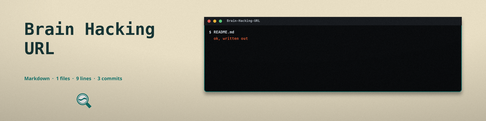

# Brain-Hacking-URL

URL that hacks the human mind

Data should be transmitted with headphones

```
https://mynoise.net/NoiseMachines/custom.php?l=6161310308172844496600&m=BINAURALPURE0~BINAURALPURE1~BINAURALPURE2~AURALSCAN4~AURALSCAN5~AURALSCAN6~AURALSCAN7~AURALSCAN8~ISOCHRONIC9~AURALSCAN9&orig=1&title=Custom%20Brainhacking%20Audio
```

## Local implementation

`brainwave.py` generates the same class of audio on your own machine, with
no network access: binaural beats (a slightly different pure tone in each
ear, so the brain perceives the difference as a beat) and isochronic tones
(a single tone pulsed on and off at the beat rate). Output is a standard
stereo WAV file at 44100 Hz. Use headphones for binaural beats, because
the effect depends on each ear receiving a different tone.

Requirements: Python 3, standard library only.

```bash
python3 brainwave.py                              # 10 Hz alpha binaural, 60 s
python3 brainwave.py --beat 6 --duration 300      # theta session
python3 brainwave.py --mode isochronic --beat 18  # beta, isochronic
python3 brainwave.py --help                       # all options
```

Options: `--mode binaural|isochronic` (default binaural), `--base` carrier
tone in Hz (default 220), `--beat` beat frequency in Hz (default 10),
`--duration` seconds (default 60), `--volume` 0.0 to 1.0 (default 0.5),
and `-o`/`--output` for the WAV path (default `brainwave.wav`).

Beat guide from the script: delta 0.5 to 4 Hz (sleep), theta 4 to 8
(meditation), alpha 8 to 13 (relaxed focus), beta 13 to 30 (alertness),
gamma 30 and up (concentration). A beat of 0 is accepted and produces a
plain unmodulated tone.

Validation: base must be above 0, beat must be 0 or above, duration must
be above 0, volume must be in (0, 1], and every value must be a finite
number. Three more checks look at the tones that would actually reach
the file, and they are the ones I added last, because each of them used
to write a plausible looking file with the wrong sound in it:

- In binaural mode, a beat wider than twice the base would push the
  left tone below 0 Hz, where it renders as a mirrored tone instead of
  the one asked for. That is refused. In isochronic mode the beat only
  gates the carrier, so a wide beat stays legal there.
- A tone above 22050 Hz, half the 44100 Hz sample rate, cannot be held
  by the samples and folds down to a lower frequency on playback. In
  binaural mode both ear tones are checked (base plus and minus half
  the beat); in isochronic mode the base is checked.
- A duration shorter than one frame (1/44100 s) would write a valid
  WAV header with zero frames of audio in it. That is refused too;
  the old behavior printed the success line over an empty file.

Invalid values print one error line to stderr and exit 1, with no
output file written by the validation path. An output path that
cannot be opened (a folder that does not exist, a folder named as
the file) also exits 1 with one error line and no traceback. Files
start with a fade in and end with a fade out (up to 2 seconds each,
capped at half the file length) so short files still reach the
requested volume.

Verified by running the tool: 1 second and 5 second WAVs in both modes
have the correct channel count, sample rate, and frame count, isochronic
output is identical in both channels, and binaural output differs per
channel. The audio itself was generated and measured as data only; it was
not listened to, and no entrainment effect is claimed.

## Tests

```bash
python3 -m unittest
```

19 tests, all passing. The generator tests read frames directly
(count, channel split in each mode, 16 bit range, the silent first
frame from the fade). The rest run the command line as a subprocess
and check the exit code, the stderr line, and whether a file exists:
both modes writing correct files, every refusal above, the older
range checks, the unwritable path, `--help` at exit 0, and an
unknown argument at exit 2.

## Files

- `brainwave.py` - the generator
- `test_brainwave.py` - the unittest suite
- `logo.png`, `banner.png` - project branding
